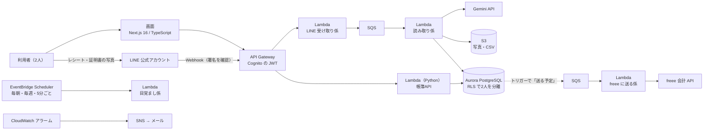

# 申告ノート（shinkoku-note）

**LINEにレシートを送るだけで帳簿がつき、freee への自動登録か、確定申告書に入れる数字まで出せる**、ひとりで仕事をする人（個人事業主・業務委託）のためのWebアプリです。
確定申告をまったく知らない人でも、質問に答えて写真を送るだけで申告まで進めることを目指して、夫婦2人で実際に使うために作りました。

> 設計書：[docs/design.md](docs/design.md) ／ 税のルールと出典：[docs/tax-rules.md](docs/tax-rules.md)

## 課題 → 手段 → 理由 → 成果

| 型 | 内容 |
|---|---|
| **課題** | 2026年から夫婦ともフリーランスに。レシートの整理・科目分け・源泉徴収・控除・消費税…と、確定申告は「知らないこと」と「手間」のかたまり。会計ソフトは借方・貸方の画面がむずかしい |
| **手段** | 入口を LINE の写真・CSV・ふだんの言葉の入力にしぼり、裏で複式簿記の仕訳にする。AI（Gemini）が読み取り、自信があるものだけ自動で確定。freee を使う人には自動登録、使わない人にはアプリの中で申告の数字まで出す |
| **理由** | 「入れるのが面倒」が続かない一番の理由なので、記録は写真1枚・設定1回で済む形に。帳簿を複式簿記で持つことで、白色の収支内訳書も、freee への送信も、将来の青色申告も同じデータから作れる |
| **成果** | Phase 0〜7 を1日で設計・実装・公開（PR 18本）。自動テスト：API 249件・AWSの設定 25件・画面 単体14件＋E2E 26件。税額の計算は国税庁のページ・法令の表を直接確かめた数字だけを使い、すべて出典つきでDBに保存 |

## できること

| | 機能 |
|---|---|
| 📸 | **LINEにレシートを送るだけで記録**。日付・金額・お店・科目をAIが読み取り、自信があれば自動で確定、あやしいものだけ「確認待ち」。直した科目は覚えて次から自動に |
| 📄 | **控除証明書も写真で**。国民年金・生命保険・ふるさと納税・源泉徴収票などを見分けて、確定申告の準備に入れる |
| 🏦 | **銀行・カードのCSV**（Shift_JIS／UTF-8、いろいろな見出しの形）を読み、仕事の分だけ✅して取りこむ。同じ行は二度取りこまない |
| 🔁 | **毎月の固定費**（家賃・スマホ代…）を家事按分つきで自動記録。過去の月からまとめて記録もできる |
| 🔗 | **freee 連携**（OAuth）。確定した記録を freee の「取引」「振替伝票」に自動登録、レシートはファイルボックスへ。直したら送りなおし、消したら freee でも消す |
| 📋 | **確定申告の準備**。質問に答えると税額のめやすがその場で出る。チェックリスト、「申告の日に入れる数字」の一覧、印刷・PDF |
| 🧮 | 所得税：事業所得・給与所得・すべての主な所得控除・減価償却・源泉徴収・予定納税（2025年分・2026年分） |
| 🧾 | 消費税（インボイス登録者）：2割特例・簡易課税 |
| 🔔 | 確認待ちを週1でLINEにお知らせ。エラーや失敗はメールで見張り |

## 構成

| 分野 | 使ったもの |
|---|---|
| 画面 | Next.js 16（静的書き出し）・TypeScript・Tailwind CSS v4・Amplify Auth（Cognito） |
| API・処理 | AWS Lambda（Python 3.13・arm64）・API Gateway（HTTP API）・SQS＋DLQ・EventBridge Scheduler |
| DB | Amazon Aurora PostgreSQL（エクスプレス構成・IAM認証・RLS・トリガー） |
| インフラ | AWS CDK（TypeScript）。コンソールで手作業しない |
| CI/CD | GitHub Actions：PR で型チェック・テスト（PostgreSQL 17 のサービスコンテナ）・E2E、main で OIDC（鍵なし）で自動公開 |
| 鍵 | Systems Manager パラメータストア（SecureString）。Lambda ごとに読める名前だけ許可 |
| 外部 | LINE Messaging API・freee 会計 API（OAuth 2.0）・Gemini API |

## 工夫したところ

- **2人のデータを2重に守る**：API でログイン中の人に絞るうえ、DB の RLS（行レベルセキュリティ）でも他人の行を見えなくした。API は権限をしぼった専用ユーザーでつなぐので、SQL を直接たたいても他人の行は見えない（テストで確認）
- **帳簿のルールは DB が守る**：「借方の合計＝貸方の合計」を COMMIT 時に確かめる制約トリガー。金額は円の整数だけ
- **税のルールはコードに書かない**：基礎控除・税率・償却率などは年ごとに `tax_rules` テーブルへ、国税庁・e-Gov の出典URLつきで。記憶で書かず、ページや法令の表を直接読んで確かめた（定額法の償却率は 3年＝0.334・9年＝0.112 のように 1÷年数 ではない、など）
- **失敗する前提の外部連携**：LINE・freee・Gemini は SQS で非同期にし、自動でやりなおし→だめなら DLQ＋メール。同じ写真・同じ CSV の行・同じ月の固定費は二度記録しない（冪等）
- **freee への送信漏れをなくす**：画面・LINE・固定費・CSV どこから記録しても、DB のトリガーが「送る予定」を拾う
- **お金をかけない**：NAT を作らず、DB は使わないとき0まで縮む構成。予算アラートつき

## つまずいて、直したこと

| 起きたこと | 原因 | どうしたか |
|---|---|---|
| GitHub Actions から AWS に入れない | GitHub の OIDC トークンの sub が「名前＠番号」の形（immutable subject）になっていた | 信頼ポリシーを番号つきの形に合わせた（なりすましにも強くなる） |
| CloudFront が作れない | 新しい AWS アカウントは確認が終わるまで作れない | 画面の配信だけ別スタックに分けて後回しに。本体は先に公開 |
| DB が作れない（2回） | 無料プランでは バックアップ1日まで・Aurora はエクスプレス構成のみ | 設定を合わせ、VPC なし・IAM 認証の構成に作りかえた |
| DB の暗号化が指定できない | エクスプレス構成が未対応 | TLS＋IAM 認証で守り、設計書の「わかっている課題」に記録 |
| 失敗のたびに空の部品が残る | 「消しても残す」設定がロールバックでも残る | 「作成に失敗したときは残さない」設定（RetainExceptOnCreate）に |
| LINE の検証が時間切れ | DB が寝ていると起動に約30秒／最初の1回は鍵の取り出しで1.3秒 | 受け取り係は DB にさわらず SQS に入れるだけにし、5分ごとに温めておく |
| マージ記録に本物のメールアドレス | GitHub の画面でマージしたため | 履歴を書き直して force push、GitHub でメールを非公開に |

## 動かし方

| やりたいこと | 場所・コマンド |
|---|---|
| API のテスト | `api/`：`python -m pytest`（Docker の PostgreSQL 17 をポート 55432 で） |
| AWS の設定のテスト | `infra/`：`npm test` |
| 画面（お試しモード：AWSにつながない） | `web/`：`npm run dev:mock` → http://localhost:3100 |
| 画面（本物） | `web/`：`.env.example` を `.env.local` にして `npm run dev` |
| 画面のテスト | `web/`：`npm test`、`npm run build:mock && npm run e2e` |
| 公開 | main にマージすると GitHub Actions が自動で反映 |

## 進み具合

| Phase | 内容 | 状態 |
|---|---|---|
| 0 | 設計・準備 | ✅ |
| 1 | 土台をコードで（CDK・GitHub Actions） | ✅ |
| 2 | DBと帳簿API | ✅ |
| 3 | 画面 | ✅ |
| 4 | 取りこみ（LINE・CSV・くり返し） | ✅ |
| 5 | freee連携 | ✅ |
| 6 | 申告の計算・ガイド・控除証明書・減価償却 | ✅ |
| 6.5 | インボイス（消費税） | ✅ |
| 7 | 仕上げ（見張り・README） | ✅（画面の公開は AWS アカウントの確認待ち） |

## わかっている課題

- DB の保存データの暗号化（エクスプレス構成が未対応）
- 画面のインターネット公開（CloudFront は AWS アカウントの確認待ち。それまでは手元で動かす）
- 本則課税、8%の売上、青色申告決算書（貸借対照表）は未対応
- 令和8年分の「確定申告の手引き」が出たら、計算の順番と端数を照らし合わせる
