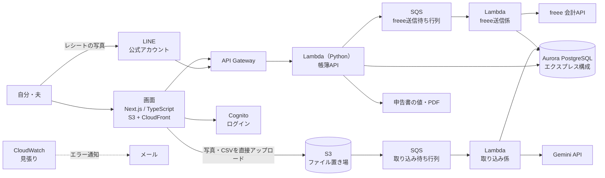

# 申告ノート（shinkoku-note） 設計書（ドラフト）

> 個人事業主（業務委託）が、レシート・銀行やカードのCSV（シーエスブイ）・手入力から帳簿をつけて、
> **freee（フリー）を使っている人はfreeeに自動で登録**、**使っていない人はこのアプリの中で確定申告の値まで出せる**システム。
> 2人（自分と夫）で使い、それぞれ自分のデータだけが見える。

※ カタカナ・英語の用語には、初めて出てくるところに（読み方）を付けています。
※ 名前（申告ノート）は仮。あとで変えてOK。

## 1. 課題 → 手段 → 理由 → 成果

| 型 | 内容 |
|---|---|
| **課題** | 確定申告のたびに、レシートや明細を集めて科目を分けて、合計して…が大変。freeeを使っている人も、レシートやカード以外の明細の入力は手作業が残る。使っていない人は1年分をまとめて計算することになる。 |
| **手段** | 入口（レシート写真・CSV・手入力）を1つにまとめて仕訳（しわけ）にする。freee連携モードならfreeeに自動登録、アプリ内モードならSQL（エスキューエル）で集計して収支内訳書と申告書の値を出す。 |
| **理由** | 帳簿を「複式簿記（ふくしきぼき）」の形で持っておけば、白色申告の収支内訳書も、将来の青色申告決算書も、同じデータから作れる。freeeに送るときも同じ形のまま渡せる。 |
| **成果** | （Phase 7で記入）例：2026年分の申告を2人ともこのアプリで完了／仕訳○件／入力にかかった時間○分 |

## 2. できること

### 2人それぞれ「モード」を選べる

| モード | 向いている人 | 流れ |
|---|---|---|
| **freee連携モード** | freeeを使っている人（自分） | 入力 → 仕訳の下書き → 確認して確定 → **freeeに取引として自動登録**（レシート画像もfreeeのファイルボックスへ） → 申告書はfreeeで作る |
| **アプリ内モード** | freeeを使っていない人（夫） | 入力 → 仕訳の下書き → 確認して確定 → このアプリで**収支内訳書＋確定申告書に入れる値の一覧＋下書きPDF（ピーディーエフ）** → 国税庁の「確定申告書等作成コーナー」に転記して提出 |

### いちばん大事：レシートを送ったら勝手に記録

**LINE（ライン）にレシートの写真を送るだけ**で、帳簿に入る（freee連携モードならfreeeにも自動で登録）。アプリを開く必要はない。

1. LINEの公式アカウント（このアプリ専用）に写真を送る
2. AI（Gemini（ジェミニ））が日付・金額・お店・科目を読み取る
3. **自信があるものは自動で確定**して、LINEに「消耗品費 3,300円 で記録したよ」と返事
4. **あやしいものだけ「確認してね」リストへ**：金額や日付が読めない／初めてのお店で科目に迷う／同じレシートを2回送ったかも
5. 週に1回、LINEで「確認待ちが○件あるよ」とお知らせ

自動で確定する条件（あとで調整できるように設定で持つ）：
- 日付・金額・お店がすべて読めた
- そのお店で前に選んだ科目がある（`partner_rules`）、またはAIの自信度が高い
- 同じ画像・同じ日付と金額のレシートがまだない（二重登録の防止）

自動で確定したものも、あとから画面で直せる（直したらfreeeにも反映）。直した科目は覚えて、次から同じお店はその科目にする。

### ほかの入口

1. **銀行・カードのCSV**：明細を取り込んで科目をつける。ルールは写真と同じ（覚えたお店は自動確定、それ以外は確認リスト）
2. **画面から写真をアップロード**：まとめて何枚も入れたいとき
3. **手入力**：報酬の入金、家賃の家事按分（かじあんぶん／仕事で使う割合だけ経費にする）など

### 確定申告に必要なものは全部ここで

帳簿（売上・経費）だけでなく、申告書に書くものを全部登録できるようにする。**下の表のどれも「手入力」と「写真の読み取り」の両方で登録できる**。

- **読み取り**：控除証明書や支払調書もLINEに写真を送る（または画面からアップロード）と、AIが種類を見分けて中身を読み取る（年末〜1月にハガキが届いたら撮って送るだけ）。自動で確定する条件はレシートと同じで、あやしいものは確認リストへ
- **手入力**：書類がない・手元の数字を打ちたいときは、画面のフォームから入れる。読み取ったものも同じフォームで直せる
- どちらで入れても同じテーブルに入り、`source`（`manual` / `photo`）で入れ方を記録する

| 区分 | 登録するもの | 書類の例 |
|---|---|---|
| **収入** | 事業の売上（報酬） | 請求書・入金 |
| | **源泉徴収（げんせんちょうしゅう）された税金**（取引先ごと） | 支払調書（しはらいちょうしょ）・明細 |
| | ほかの所得（給与・雑所得など、あれば） | 源泉徴収票 |
| **経費** | 科目ごとの経費、家事按分（家賃・通信費・電気代など） | レシート・明細 |
| | **減価償却（げんかしょうきゃく）**：10万円以上のパソコンなど、何年かに分けて経費にするもの | 購入時の領収書 |
| | 事業専従者控除（家族が仕事を手伝っている場合） | — |
| **所得控除** | **社会保険料**：国民健康保険・国民年金・国民年金基金・介護保険（家族の分を払った場合も） | 納付書・控除証明書 |
| | 小規模企業共済・iDeCo（イデコ） | 掛金の証明書 |
| | 生命保険料（一般・介護医療・個人年金） | 控除証明書 |
| | 地震保険料 | 控除証明書 |
| | 寄附金（ふるさと納税） | 寄附の受領証 |
| | 医療費（またはセルフメディケーション税制） | 医療費のお知らせ・レシート |
| | 配偶者・扶養の家族 | — |
| | 障害者・ひとり親・勤労学生など（あてはまる場合） | — |
| | 基礎控除（自動で計算） | — |
| **税額控除・その他** | 住宅ローン控除（あれば） | 残高証明書 |
| | 予定納税（前の年の税金が多いと、先に払っている分） | 通知書 |
| **住民税・事業税の欄** | 住民税の払い方（普通徴収など）、事業税に関すること | — |

**申告チェックリスト画面**：「国民年金の控除証明書がまだ」「源泉徴収の記録がない取引先がある」など、**足りないものを一覧で出す**。全部そろったら申告に進める。

※ 何がいくら控除になるか、どの年から変わったかは、年度ごとに国税庁の資料で確認して `tax_rules` に入れる（記憶で書かない）。

### 確定申告をまったく知らなくても使える

**「確定申告ってなに？」の人でも、質問に答えて写真を送るだけで最後までいける**のが目標。

- **はじめの質問（10問くらい）**：「お給料はもらってる？」「国民健康保険？会社の保険？」「年金は払ってる？」「家族を養ってる？」「インボイス登録してる？（わからなければ『わからない』でOK→調べ方を案内）」など、はい/いいえで答えるだけ。答えから下の「設定」を自動で作る
- **むずかしい言葉を使わない**：画面では「経費」→「仕事で使ったお金」、「消耗品費」→「仕事の道具・文房具（消耗品費）」のように、ふだんの言葉を先に書いて、正式な名前はカッコで添える
- **全部の項目に「これなに？」**：押すと1〜2行のやさしい説明と例が出る
- **1年のやることカレンダー**：「11月：控除証明書のハガキが届くよ→届いたら写真を送ってね」「2月：申告の時期だよ」のように、いつ何をすればいいかをLINEでお知らせ
- **申告の日のガイド**：国税庁の確定申告書等作成コーナーで、**どの画面のどの欄にどの数字を入れるか**を1画面ずつ順番に案内する（「次へ」を押していくだけ）
- **迷ったら「わからない」を選べる**：その項目は確認リストに入り、あとで説明を読んでから決められる。わからないまま進めなくても困らない

※ 書く内容は国税庁の案内に合わせ、税金の判断が必要なところ（これは経費になる？など）は「よくある考え方」と国税庁のページへのリンクを出す。言い切りが難しいものは「税務署や税理士に確認してね」と出す。

### 毎回おなじものは「設定」で1回だけ

**いちいち入力しない**のが基本。くり返すものは設定画面で1回登録すれば、あとは自動で記録する。

| 設定 | 例 | 自動でやること |
|---|---|---|
| **毎月の固定費** | 家賃・ネット代・スマホ代・サブスク（金額・科目・家事按分・引き落とし日） | 毎月その日に仕訳を自動で作る。金額が変わったら設定を直すだけ |
| **毎月・毎年の社会保険料** | 国民健康保険・国民年金・国民年金基金・iDeCo・小規模企業共済 | 払う予定どおりに控除として自動で積み上げる。年末に控除証明書が届いたら、読み取った金額と比べてずれだけ知らせる |
| **毎年の保険・家族** | 生命保険・地震保険、配偶者・扶養の家族 | 次の年度を作るときに**前の年からそのまま引き継ぐ**（変わったところだけ直す） |
| **取引先** | 報酬をくれる会社、源泉徴収されるかどうか | 入金を記録したら、源泉徴収の分を自動で計算してつける |
| **科目と税区分の初期値** | 「Amazonは消耗品費」「電気代は事業50%」 | 写真・CSV・固定費のどれから入っても、この設定で科目・按分・税区分を自動でつける |

自動で作ったものは仕訳の `source` を `recurring`（くり返し設定）にして、どこから来たか分かるようにする。

### インボイス登録は「チェックを入れたらその仕様」

設定画面に **「インボイス登録している」のチェック**を置く。チェックの有無で、アプリの動きが切り替わる。

| | チェックなし | チェックあり |
|---|---|---|
| 仕訳の入力 | 税区分は出さない（内部では「対象外」扱い） | 仕訳ごとに**税区分（課税10%・軽減8%・非課税・対象外など）**を持つ。科目ごとの初期値から自動でつく |
| レシートの読み取り | 日付・金額・お店・科目 | 上に加えて**相手の登録番号（T＋13桁）と税率ごとの金額**も読む |
| 設定項目 | — | 登録番号、登録した日、**計算のしかた**（2割特例・簡易課税・本則課税）、簡易課税なら事業区分 |
| 申告チェックリスト | 所得税だけ | 消費税の項目も追加 |
| 出力 | 所得税の申告書の値 | **消費税の申告書の値**も出す |
| freee連携 | — | 税区分もfreeeに一緒に送る |

途中の年から登録した場合に備えて、「登録した日」より前の取引は自動で対象外として扱う。使える計算のしかたや特例の期間は年度ごとに変わるので、`tax_rules` に入れて、その年に選べるものだけを画面に出す。

### 業務委託ならではの機能

- **源泉徴収の記録**：報酬から引かれている税金を取引先ごとに記録。入金額から「報酬−源泉徴収＝入金」を逆算して候補を出す。申告で戻ってくる（還付）か、払うかの計算に使う
- **家事按分**：家賃・通信費・電気代などに割合を設定すると、経費の金額を自動で計算

### やらないこと（今は）

- e-Tax（イータックス）への直接提出（国への登録などが重いため。作成コーナーへの転記で提出する）
- 青色申告の65万円控除の要件まわり（優良な電子帳簿など）。**青色申告決算書は Phase 8 以降で追加**する前提で、データの形だけ最初から合わせておく
- 他の人への一般公開（計算の責任が重いため。公開するなら「計算の補助・下書き」と明記）

## 3. 全体構成

設定はすべて **CDK（シーディーケー）でTypeScriptのコードとして書き**、GitHub Actions（ギットハブ・アクションズ）から自動で反映する（コンソールで手作業しない）。

図に出てくる名前の読み方：

| 表記 | 読み方 | ひとことで言うと |
|---|---|---|
| S3 | エススリー | ファイルを置いておく倉庫 |
| CloudFront | クラウドフロント | S3に置いた画面を速く・安全に配る仕組み |
| Cognito | コグニート | ログイン機能 |
| API Gateway | エーピーアイ・ゲートウェイ | APIの受付窓口 |
| Lambda | ラムダ | 呼ばれたときだけ動くプログラム |
| Aurora PostgreSQL（エクスプレス構成） | オーロラ・ポストグレスキューエル | 使うときだけ動くSQLのデータベース。使っていないと止まって安くなる。無料プランではこの作り方しか使えない |
| IAM認証 | アイアム認証 | パスワードの代わりに、AWSの通行証でDBにつなぐ仕組み |
| SQS | エスキューエス | 「あとでやる仕事」を順番に並べておく待ち行列 |
| DLQ | ディーエルキュー（デッドレター・キュー） | 何回やっても失敗した仕事を取っておく場所 |
| Secrets Manager / KMS | シークレッツ・マネージャー／ケーエムエス | パスワードや鍵を暗号化してしまっておく金庫 |
| CloudWatch | クラウドウォッチ | ログとエラーの見張り番 |
| CDK | シーディーケー | AWSの設定をプログラムで書く道具 |
| OAuth | オーオース | 「freeeのデータをこのアプリが使ってOK」と許可する仕組み |
| OIDC | オーアイディーシー | GitHubから鍵なしで安全にAWSへ入る仕組み |

### なぜこの組み合わせ？

- **Aurora のエクスプレス構成**：無料プランではこの作り方しか使えない（2026-11-21に判明）。ネットワーク（VPC）を使わず、インターネット経由の入口に**IAM認証（AWSの通行証）を持つものだけ**がつながる。普通のRDSだとVPCと、外へ出るためのNAT（月数千円）が要るが、それもいらない。使わないときは0まで縮むので安い
- **画面は静的な書き出し（S3＋CloudFront）**：画面はブラウザから直接APIを呼ぶ作りにして、サーバーを持たない。AWSの基本の配信方法も覚えられる
- **SQSで裏に回す**：写真の読み取りやfreeeへの送信は時間がかかったり失敗したりする。待ち行列に入れて、失敗したら自動でやり直し、それでもダメならDLQに残して通知

## 4. 部品ごとの役割と、学べること

| 部品 | 役割 | 学べること |
|---|---|---|
| Aurora PostgreSQL | 仕訳・科目・源泉徴収・控除を保存。集計はSQLのビュー | **SQL**（複式簿記の集計・試算表）、マイグレーション（DBの変更履歴の管理） |
| Lambda（Python） | 帳簿API・取り込み・freee送信・申告の計算 | **Python**、pytest（パイテスト／自動テスト） |
| Next.js（TypeScript） | 入力・確認・一覧・集計・申告の画面 | **TypeScript・Next.js**、Vitest（ヴィテスト）・Playwright（プレイライト）での画面テスト |
| Cognito | ログイン、2人のデータを分ける | **ログイン・権限・複数人** |
| S3・SQS・DLQ | ファイル置き場と裏の処理 | **非同期処理・やり直し・失敗の扱い** |
| freee連携 | OAuthで許可をもらい、取引を自動登録 | **外部サービス連携**（トークンの更新、回数制限、二重登録の防止） |
| CDK | AWSの設定をすべてコードで | **インフラのコード化**、TypeScript |
| GitHub Actions | pushでテスト、mainに入ったら自動で公開 | **GitHub・CI/CD（シーアイ・シーディー）** |
| CloudWatch・予算アラート | エラーと料金の見張り | **監視・コスト管理**（AWS資格の範囲） |
| CLAUDE.md・Issue→PRの流れ | AIに説明書を渡し、Issueごとにブランチ→PR→レビュー | **Claude Code・Cursor（カーソル）でのAI開発**を面接で話せる形に |

## 5. データベース（最初の案）

### 帳簿の中心：複式簿記

1つの取引（仕訳）を「借方（かりかた）」と「貸方（かしかた）」の行に分けて持つ。例：

| 日付 | 借方 | 貸方 | 金額 |
|---|---|---|---|
| 1/10 | 消耗品費 | 事業主借（じぎょうぬしかり／私物のお金で払った） | 3,300 |
| 1/31 | 普通預金 | 売上 | 90,000 |
| 1/31 | 事業主貸（じぎょうぬしかし／源泉徴収分） | 売上 | 10,000 |

白色申告は「売上・経費」の行だけ集計すれば収支内訳書になる。青色にするときは、預金や事業主貸・借の残高も集計して貸借対照表を出す。**同じデータのまま両方に対応できる**のがこの形のいいところ。

### テーブル

| テーブル | 主な列 |
|---|---|
| `profiles`（利用者の設定） | user_id（Cognitoの番号）, display_name, filing_type（`white`＝白色 / `blue`＝青色）, mode（`freee` / `in_app`）, business_name（屋号） |
| `invoice_settings`（インボイスの設定） | user_id, registered（チェック）, registration_number（T＋13桁）, registered_on, ct_method（`two_tenths`＝2割特例 / `simplified`＝簡易課税 / `standard`＝本則課税）, business_category（簡易課税の事業区分） |
| `fiscal_years`（年度） | id, user_id, year（2026など）, status（`open`＝入力中 / `closed`＝締めた） |
| `accounts`（勘定科目） | id, code, name（消耗品費など）, kind（資産・負債・元入金・収益・費用）, white_line（収支内訳書のどの欄か）, blue_line（青色決算書のどの欄か） |
| `journal_entries`（仕訳） | id, user_id, fiscal_year_id, entry_date, description（摘要）, partner（取引先）, status（`draft`＝下書き / `confirmed`＝確定）, source（`manual` / `csv` / `receipt`）, import_file_id |
| `journal_lines`（仕訳の行） | id, entry_id, side（`debit`＝借方 / `credit`＝貸方）, account_id, amount（円・整数）, tax_category（税区分。インボイスなしなら`out_of_scope`）, tax_rate（10 / 8 / なし）, counterparty_invoice_no（相手の登録番号） |
| `allocation_rules`（家事按分） | id, user_id, account_id, business_ratio（0〜100%） |
| `recurring_rules`（くり返し設定） | id, user_id, kind（`expense`＝固定費 / `deduction`＝社会保険料など）, name, amount, account_id または deduction_kind, cycle（毎月・毎年）, day_of_month, start_on, end_on, business_ratio, tax_category |
| `partners`（取引先） | id, user_id, name, withholding（源泉徴収されるか）, default_account_id |
| `partner_rules`（覚えた科目） | id, user_id, keyword（お店の名前など）, account_id |
| `import_files`（取り込んだファイル） | id, user_id, s3_key, image_hash（同じ画像の二重登録防止）, kind（`csv` / `receipt`）, via（`line` / `web`）, status（`queued` / `auto_confirmed` / `needs_review` / `failed`）, review_reason（確認が必要な理由）, error |
| `line_links`（LINEとのひも付け） | user_id, line_user_id（LINE側の利用者番号） |
| `withholdings`（源泉徴収） | id, user_id, fiscal_year_id, payer（支払った会社）, gross_amount（報酬）, withheld_tax（引かれた税金） |
| `other_incomes`（事業以外の所得） | id, user_id, fiscal_year_id, kind（給与・雑所得など）, revenue, expense_or_deduction, withheld_tax |
| `fixed_assets`（減価償却する物） | id, user_id, name, acquired_on, cost, useful_life（耐用年数）, method（定額法・一括償却など）, business_ratio |
| `deductions`（所得控除） | id, user_id, fiscal_year_id, kind（社会保険料・小規模企業共済等・生命保険料・地震保険料・寄附金・医療費・障害者など）, detail（JSON：保険の種類・新旧、誰の分かなど）, amount, document_file_id（控除証明書の画像） |
| `family_members`（配偶者・扶養の家族） | id, user_id, relation, birth_date, estimated_income, flags（同居・障害者など） |
| `tax_credits`（税額控除・予定納税など） | id, user_id, fiscal_year_id, kind（住宅ローン控除・予定納税など）, amount, detail |
| `filing_options`（住民税・事業税の欄など） | user_id, fiscal_year_id, options（JSON） |
| `tax_rules`（年度ごとの税のルール） | year, key（基礎控除・税率表など）, value（JSON（ジェイソン））, source_url（国税庁の根拠ページ） |
| `freee_connections`（freeeとの接続） | user_id, company_id（freeeの事業所番号）, refresh_token（KMSで暗号化）, expires_at |
| `freee_account_map`（科目の対応表） | user_id, account_id, freee_account_item_id |
| `freee_syncs`（freeeへの送信記録） | entry_id, freee_deal_id, status（`pending` / `sent` / `failed`）, attempts, last_error |
| `audit_logs`（操作の記録） | id, user_id, action, target, created_at |

### 大事なルール

- **全部のテーブルに user_id を持たせ、APIは必ずログイン中の人の user_id で絞り込む**。「夫のデータが見えない」ことを自動テストで確認する
- **金額は円の整数**で持つ（小数のずれを防ぐ）。仕訳ごとに「借方の合計＝貸方の合計」をDBのチェックで守る
- **税のルール（基礎控除の額・税率など）はコードに直接書かず `tax_rules` に年度ごとに入れる**。毎年変わるので、国税庁の資料を確認して根拠のURLと一緒に入れる
- **freeeへの二重登録を防ぐ**：送信前に `freee_syncs` を見て、送信済みなら送らない。やり直しても同じ結果になるようにする

## 6. 申告の計算（アプリ内モード）

1. 確定した仕訳から、収支内訳書の欄ごとの合計を出す（売上・経費の科目別、家事按分・減価償却を反映）
2. 事業所得 ＝ 売上 − 経費（−事業専従者控除）。ほかの所得があれば足す
3. 所得控除（社会保険料・生命保険料・医療費・寄附金・配偶者や扶養・基礎控除など）を引いて、課税される所得を出す（1,000円未満切り捨て）
4. 年度の税率表で所得税 → 復興特別所得税を足す（100円未満切り捨て）
5. 税額控除（住宅ローン控除など）を引き、源泉徴収された税金と予定納税を引いて、**払う金額 or 戻ってくる金額**を出す
6. 確定申告書等作成コーナーの入力画面の順番どおりに「ここにこの数字」の一覧と、下書きPDFを出す

計算のテストは、国税庁の計算例や、去年自分で出した申告の数字を答えにして、Pythonの自動テストで確認する。

## 7. 料金の見張り

- AWSは無料プランのクレジット（$100・183日）を使う。**最初に予算アラート（$10・$30）を入れる**
- Aurora は使っていないときに0まで縮む設定にする（最初の1回の応答は少し遅くなる）
- Gemini は写真1枚につき1回だけ呼ぶ。freee APIは無料

## 8. フェーズとスケジュール

1日6時間・日曜休み。目標は**12月中旬に完成 → 年末〜1月に2026年分を入力 → 2/16からの申告で2人とも使う**。

| Phase | 内容 | 予定 |
|---|---|---|
| 0 | 設計・リポジトリ作成・CLAUDE.md・AWSの予算アラート（freeeの開発者アプリはPhase 5、LINEのチャネルはPhase 4で登録） | 11/21（土） |
| 1 | 土台をコードで作る：CDKでCognito・Aurora・S3・CloudFront、GitHub ActionsからOIDCで自動反映 | 11/23（月）〜11/24（火） |
| 2 | DBと帳簿API：テーブル作成、仕訳の登録・一覧API（Python）、pytest、2人のデータが混ざらないテスト | 11/25（水）〜11/27（金） |
| 3 | 画面：ログイン、**はじめの質問**、仕訳の入力・一覧・確定、科目別の集計、ふだんの言葉の表示と「これなに？」（Next.js） | 11/28（土）〜12/1（火） |
| 4 | 取り込み：LINEに写真を送る・CSV → S3 → SQS → Lambda（Gemini）→ 自動確定 or 確認リスト、LINEに返事。二重登録防止、失敗時のやり直しとDLQ。**くり返し設定**（EventBridge Scheduler（イベントブリッジ・スケジューラー）で毎日1回、その日の固定費・社会保険料を自動で記録） | 12/2（水）〜12/4（金） |
| 5 | freee連携：OAuth、科目の対応表、確定した仕訳をfreeeに自動登録、レシート画像も送る、二重登録防止 | 12/5（土）〜12/8（火） |
| 6 | 申告の計算：源泉徴収・社会保険料などの控除・家族・減価償却の入力（控除証明書もLINEで）、申告チェックリスト、収支内訳書、税額計算、値の一覧とPDF、**申告の日のガイド**、やることカレンダー（テストたくさん） | 12/9（水）〜12/12（土） |
| 6.5 | インボイス対応：設定のチェック、税区分、登録番号の読み取り、消費税の計算（2割特例・簡易・本則）と申告書の値 | 12/14（月）〜12/15（火） |
| 7 | 仕上げ：監視とエラー通知、夫に使ってもらって直す、README（リードミー）と成果の数字 | 12/16（水）〜12/17（木） |
| 8 | （あとで）青色申告決算書（貸借対照表） | 申告後 |

## 8.5 わかっている課題

| 課題 | 今の守り方 | いつ直すか |
|---|---|---|
| DBの保存データが暗号化されていない（エクスプレス構成が対応していない。2026-11-21に判明） | 通信はTLS、DBにつなげるのはIAM認証を持つLambdaだけ。インターネット経由でもパスワードでは入れない | AWSの有料プランに上げるとき、またはエクスプレス構成が対応したときに、暗号化つきで作り直す |
| 画面の配信（CloudFront）が作れない（アカウントの確認待ち） | 本体とは別のスタック（ShinkokuWeb）に分けてある | アカウントの確認が終わったら反映 |

## 9. 品質の目標（「ちゃんとしたサービス」に見えるところまで）

| 観点 | 目標 |
|---|---|
| **見た目** | Phase 3のはじめに画面のデザイン（色・文字・部品）を先に決めて、全画面でそろえる。スマホでいちばん使いやすく（LINEから開く前提）、パソコンでも崩れない。ダークモード対応 |
| **使いやすさ** | 入力はなるべく選ぶだけ。読み込み中・空っぽ・エラーのときも「次に何をすればいいか」を必ず出す。夫に実際に使ってもらって、つまずいた所を直す |
| **正しさ** | 税の計算と集計は自動テストで守る（国税庁の計算例・去年の自分の申告を答えに使う）。金額は円の整数、仕訳は借方＝貸方をDBでも確認 |
| **安全** | 2人のデータが混ざらないことをテストで確認。freeeの鍵やパスワードは暗号化して金庫へ。レシート画像は本人しか見られない |
| **こわれにくさ** | 外部（LINE・freee・Gemini）が失敗しても自動でやり直し、ダメなら通知。二重登録しない |
| **自動チェック** | pushごとにテスト・型チェック・見た目のチェック（Playwrightで画面を撮って確認）。通らないものはmainに入れない |
| **説明できる** | READMEに構成図・工夫したところ・数字（テスト件数、自動確定の割合など）。面接でそのまま話せる形 |

## 10. 進め方

SkillScopeと同じ：
- コードはClaudeが書いて、何をしているかを説明する
- ツールの操作（AWS・GitHub・freeeの設定、コマンドの実行、デプロイ）は自分で手順どおりにやる
- 各Phaseの終わりにREADMEとこの設計書を更新する
